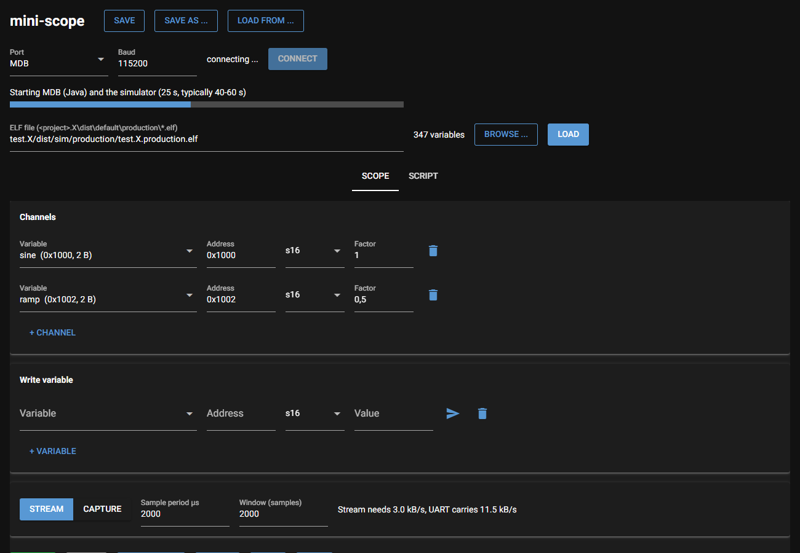
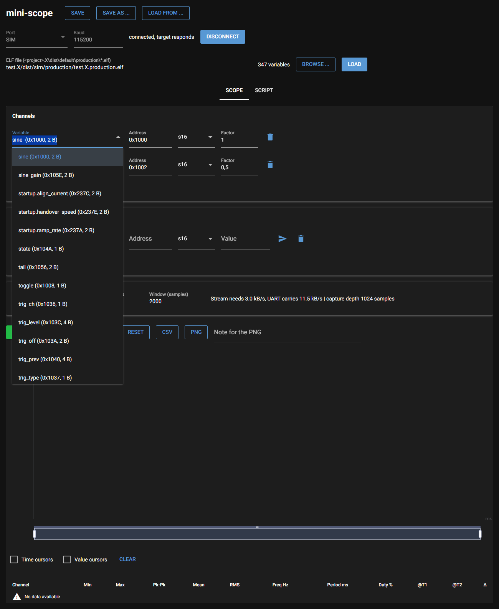
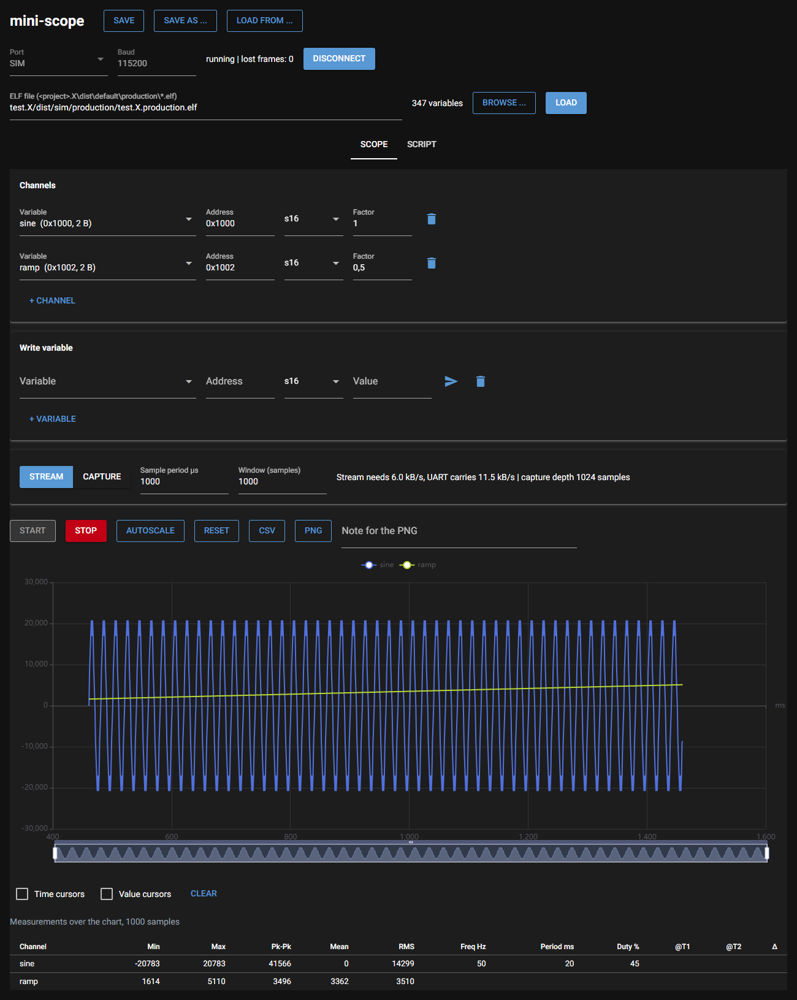
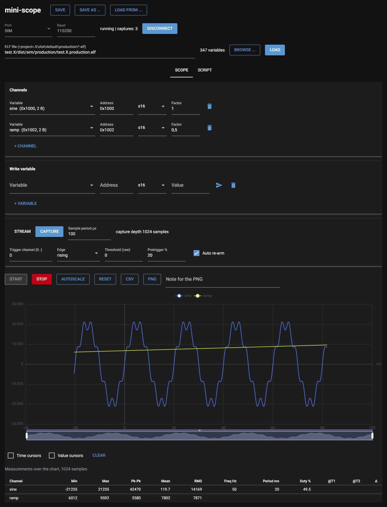

## 1. What this is about

Without a board, mini-scope can run against the **MPLAB X simulator**. The
real firmware from the test project `test.X`, compiled for the
dsPIC33CK64MC103, runs in the simulator. The user interface looks the same as
with hardware; only the port is called **MDB**.

How the parts fit together:

```
Browser (user interface)
   │
scope_gui.py  ──  tools/mdb_serial.py  ──  MDB (MPLAB X command line debugger, Java)
                                               │
                                       simulator dsPIC33CK64MC103
                                       firmware test.X (configuration "sim")
```

- **PC → firmware:** the simulator's UART has no input file for MDB.
  `mdb_serial.py` therefore writes the commands via MDB directly into a mailbox in RAM
  (`sim_rx`, `sim_rx_len` in `example_main.c`), where the firmware picks them
  up.
- **Firmware → PC:** whatever the firmware sends over its UART, the simulator
  writes to a file. `mdb_serial.py` reads that file as it grows.

**Status:** the simulator shows whether the firmware logic is right. It proves
nothing about timing, pins or the clock of a real chip. mini-scope has never run on
real hardware; every figure in this guide was measured in the simulator.

## 2. Requirements

| What | Where |
|---|---|
| MPLAB X v6.35 | `C:\Program Files\Microchip\MPLABX\v6.35` |
| XC-DSC v3.30 | `C:\Program Files\Microchip\xc-dsc\v3.30` |
| dsPIC33CK-MC_DFP 1.10.386 | in the MPLAB X pack folder |
| Python 3.9 or later | the first start sets up everything else |

For other versions, adjust the paths at the top of **`tools\mdb_serial.py`**
(`MPLABX`, `XC_DSC`, `DFP`) and in **`start_sim.bat`** (`MPLABX`).

## 3. Starting

Double-click **`start_sim.bat`** in the `mini-scope` folder.

The batch file does three things:

1. On the first start it creates the Python environment `.venv` and installs
   the packages (about a minute).
2. It builds `test.X` in configuration **sim**, but only if something has
   changed. On an error the window stays open and the reason is in
   `test.X\build_sim.log`.
3. It starts the user interface and opens the browser at
   http://localhost:8080.

Keep the console window open while you work.

## 4. Connecting

1. **Port** already shows **MDB**. Click **Connect**.
2. A progress bar shows what is happening:

| Display | What happens | Duration |
|---|---|---|
| Starting MDB (Java) and the simulator | Java and MDB start up | about 30 s |
| Simulator ready, loading firmware | the ELF is loaded into the simulator | about 5 s |
| Firmware starting, waiting for the first answer | first command to the firmware | about 5–10 s |
| Firmware responds, waiting for the last bytes | cleanup | about 6 s |

Then the bar disappears and the status line shows **"connected, target
responds"**. Altogether this takes 40–60 s.



## 5. Measuring

1. Click **Load**. The ELF of the simulator build is already filled in.
2. Click the **Variable** field and pick a variable from the list.
3. Add more variables with **+ Channel**.

The demo signals from `example_main.c` are a good start:

| Variable | Type | Shape |
|---|---|---|
| `sine` | s16 | sine, ±32767 |
| `ramp` | u16 | sawtooth 0 … 65535 (shown as `s16` it jumps at 32767) |
| `counter` | s32 | counts every pass of the main loop |
| `toggle` | u8 | alternates between 0 and 1 |
| `sine_gain` | s16 | written from the GUI (**Write variable**): amplitude of `sine`, Q15 |
| `ramp_step` | u16 | written from the GUI: slope of `ramp` |

The list also contains the internal variables of `scope.c` (`head`, `tail`,
`state` …). You normally do not need them.



### Stream

Select **Stream**, set **Sample period µs** to 1000 and click **Start**. The
curve appears after a few seconds.



### Capture

1. Click **Stop**.
2. Select **Capture** and set the sample period to 100 µs.
3. Trigger channel 0 (`sine`), edge **rising**, threshold 0.
4. Uncheck **Auto re-arm** if you want a single recording.
5. Click **Start**.

The recording appears after 10–30 s; the trigger is at 0 ms. Capture periods
below 10 µs are refused.

### Tuning scripts

The example firmware has a virtual motor (`firmware/tune_model.h`), so the tuning
scripts run in the simulator as well. In the **Script** tab, select a script, click
**Check**, then **Probe**, then **Run**. Without the GUI:

```
.venv\Scripts\python tools\run_script.py --port MDB --elf test.X\dist\sim\production\test.X.production.elf scripts\tune_startup.py
```

`tune_startup.py` takes about 3.5 minutes there. The table is the same as on the PC
model; times differ by up to one poll step (10 ms). `run.txt` in the run folder
shows on its port line for how many simulator processes power throttling was
switched off.



## 6. What is different in the simulator

- **Speed:** the simulator runs 14 to 17 times slower than real time (the port
  plans with 25), so 1 s of simulated time takes about 15 s. The time axis in the user interface
  shows the **simulated** time and is therefore correct.
- **Delay:** the simulator writes the UART file as it goes: it grows by 1 to 7
  bytes at a time, with pauses of at most 22 ms (measured). The stream is not
  held back in blocks; it only runs as slowly as the simulator.
- **Power throttling:** Windows treats a process without a window as
  background work and may switch it to its power saving mode at any moment.
  The simulator then needs 45 to 60 s per simulated second instead of 14,
  and flips between the two while it runs. After loading the firmware,
  `full_speed()` in `tools\mdb_serial.py` turns this off for the simulator
  processes. Measured with it: 13.8 to 16.8 s per simulated second, so the
  factor 25 of the port covers it. `run.txt` of a script run says on its port
  line for how many processes it worked; with 0 it warns that the simulator
  may run up to 4 times slower.
- **Standby:** if the PC goes into Modern Standby during a script run, the run
  stops. The safe end runs after wake-up. Keep the PC awake during long runs.
- **Rare events with unknown cause:** in long test series on MDB, three events
  were seen once each and never again: the stream stopped during the probe, the
  first ping got no answer, and a GUI page lost its connection during a run. Each
  ended safely, with the safe values written and read back. Their cause is not
  known. If one happens, start the run again.
- **Stop takes time:** after **Stop** the user interface waits about 6 s
  until no late bytes arrive.
- **Reset:** **Reset** restarts the firmware with the `reset` instruction, as on
  the target. If the firmware no longer answers, the user interface resets the
  simulated device through MDB instead. Allow up to 40 s.
- **No hardware effects:** noise, timing on real pins and the behaviour of the
  PICkit cannot be checked in the simulator. It only shows whether the
  firmware logic is right.
- **Receive path:** an SCL stimulus with `packetin` on `U1RXREG` reaches
  `UxRX_ISR`, and ping, `W` and a stream give the same answers as through the
  mailbox (docs/evidence/M7a.md). The simulator raises the RX interrupt only
  once per two bytes and sets no `OERR` when the FIFO overflows. The data sheet
  says one byte is enough with `URXISEL = 0` (page 278).
- **TX interrupt:** the simulator never sets `U1TXIF` by itself, not even when
  the UART is switched on. Without the software kicks not a single byte leaves.
  The firmware therefore sets the flag in software (`tx_kick()`, and every
  100 µs in the model interrupt of `example_main.c`).

Not proven in simulation, only on a real chip: the clock wait loops in
`clock_init()` (compiled out), the real frequency of FRC and PLL, the TX
interrupt of `UTXISEL = 7` without software kick, an RX interrupt per single
byte, `OERR`, framing errors, the pins, PPS and the baud rate on the wire.

## 7. Testing your own code in the simulator

1. Add your own variables and code to `firmware\example_main.c`, or add your
   own `.c` files to `test.X`.
2. **Do not remove** the mailbox polling in the main loop
   (`#ifdef __MPLAB_DEBUGGER_SIMULATOR`). It must run regularly, otherwise no
   commands arrive.
3. Put waits on hardware flags that the simulator never sets (PLL lock,
   oscillator switch) inside `#ifndef __MPLAB_DEBUGGER_SIMULATOR`.
   `example_main.c` shows how.
4. Close the console window and run `start_sim.bat` again. It rebuilds
   automatically.
5. After connecting, click **Load** again so that the new addresses apply.

The test project can also be opened in MPLAB X (`test.X`). Select
configuration **sim** to debug there with the IDE simulator, or **default**
to program real hardware with the PICkit 5.

## 8. Quitting

Click **Stop**, then close the console window or press Ctrl+C. This also ends
the simulator.

If the user interface crashed, an MDB process may be left in the background.
It shows up in Task Manager as **java.exe** with high memory use. End it in
PowerShell like this:

```powershell
Get-CimInstance Win32_Process -Filter "Name='java.exe'" |
  Where-Object { $_.CommandLine -like '*mdb.jar*' } |
  ForEach-Object { Stop-Process -Id $_.ProcessId -Force }
```

The MPLAB X IDE itself is not affected; its Java process has no `mdb.jar` in
its command line.

## 9. Troubleshooting

| Symptom | Cause and remedy |
|---|---|
| Window says "Build failed" | error in the firmware: see `test.X\build_sim.log` |
| Port **MDB** missing from the list | the user interface was not started with `start_sim.bat` |
| Progress stalls for more than 90 s, then "Error" | check the paths in `tools\mdb_serial.py`. An old MDB process may block; end it as in section 8 and start again. |
| "the firmware in the simulator sent nothing within 90 s" (after about 110 s; `hw_check.py` and `run_script.py` print it as a FAIL or ERROR line) | the firmware hangs before `scope_init()` (a wait loop), the TX path is dead (`tx_kick()` missing, see section 6), the mailbox polling in the main loop is missing, or the ELF is not a sim build (section 7, step 3) |
| "the simulator did not report ... within ... s" | MPLAB X is missing or in another place (`MPLABX` in `tools\mdb_serial.py`), an old MDB process blocks it, or the ELF could not be loaded |
| Curve stays empty, status "running" | wait a few seconds. If nothing comes, **Load** the ELF again and reselect the channels. |
| No capture appears | the threshold is never crossed: try edge **none** |
| Page stops responding | press F5 and click **Connect** again. This starts a new simulator; the old one ends when the user interface is closed. |

## 10. Fast alternative: PC model

For quick tests of the user interface there is also a model that runs
`scope.c` directly on the PC, without MPLAB X. It runs in real time and needs
no start-up time, but it does not check the compiled dsPIC firmware.

```
gcc -O2 -shared -Itests/mock -Ifirmware -o tests/sim.dll tests/mock/sim.c firmware/scope.c
start_gui.bat --sim
```

Select port **SIM**, click **Connect**, leave the ELF field empty and click
**Load**. `gcc` is available for example through MinGW. The DLL only needs
rebuilding after changes to `scope.c`.

## 11. What was compared in simulation

All of this is simulation, nothing is proven on hardware. Details are in
`docs/evidence/M7e.md` and `docs/evidence/M7e-2.md`.

- **Broken variants.** A wrong 16 bit write of a 4 byte value, a wrong 32 bit write
  of a 2 byte value and exchanged trigger edges (PC model), and a firmware without
  `tx_kick()` (MDB) were each caught by the tests. The firmware without `tx_kick()`
  ends the start-up with the message "the firmware in the simulator sent nothing
  within 90 s".
- **PC model against MDB.** All three scripts give the same table on both ports:
  status and counts equal, times within one poll step, overshoot within one count
  step. `tuning.h` is the same on both.
- **100 runs in a row on the PC model.** One process: working set 98.8 MB at the
  start, 106.2 MB after 100 runs, no thread left. Stable.
