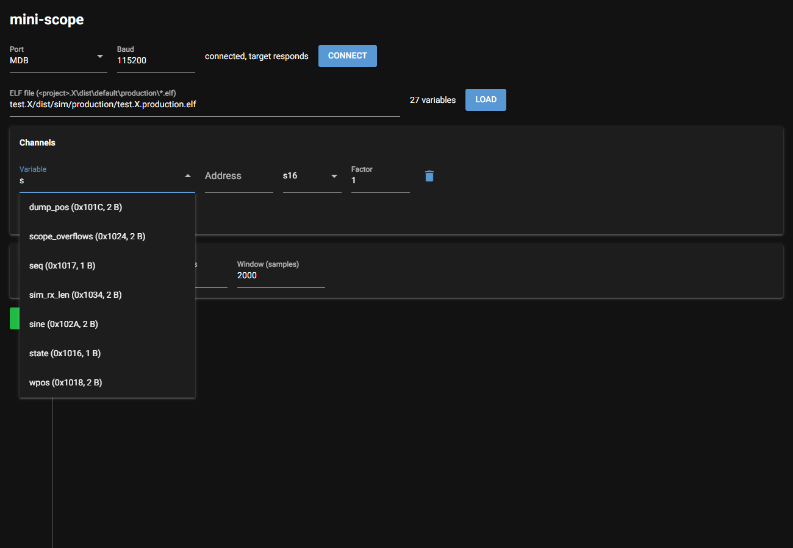
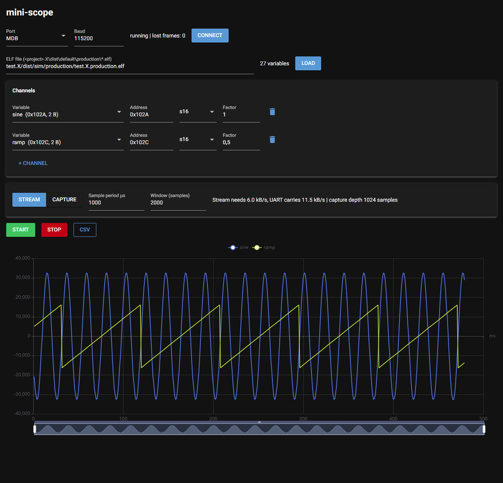
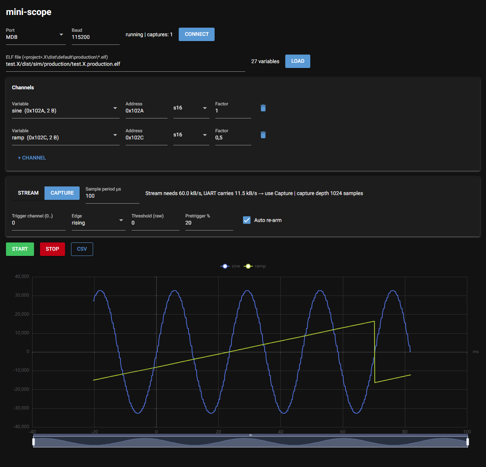
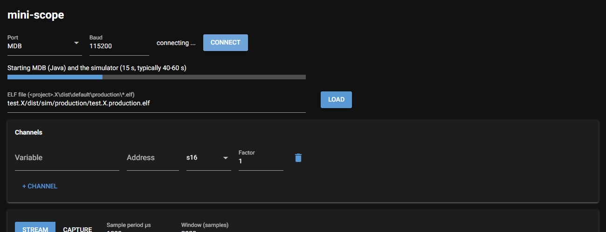

## 1. What is mini-scope for?

A debugger has to halt the CPU to read variables, which is harmful in a motor
control application. mini-scope reads the variables while the application
keeps running: a small module in the controller samples the selected
variables at a fixed rate and sends them over a UART to the PC, where they are
shown as curves in the browser.

There are two modes:

- **Stream:** continuous display, like a chart recorder. Suited to slow
  signals such as speed, temperature or states.
- **Capture:** records a short time window at any sample rate, started by a
  trigger such as a current rise or a fault. Works like a storage
  oscilloscope.

## 2. What you need

| Item | Purpose |
|---|---|
| Python 3.9 or later | PC user interface; the first start installs everything else |
| USB-UART adapter, 3.3 V, 115200 baud | connection to the board, galvanically isolated if possible |
| `scope.c` and `scope.h` in the firmware project | module in the controller |
| the project's ELF file | lets you pick variables by name |

It also works without hardware, see [section 7](#simulation-without-hardware).

## 3. Preparing the firmware

1. Add `firmware\scope.c` and `firmware\scope.h` to the MPLAB X project.
2. Call `scope_init();` once in `main()`, after the clock and pin setup.
   `scope_init()` configures PPS, UART, timer and interrupts. Nothing else is
   needed.
3. If your application already uses UART1 or Timer1, select a free one at
   the top of `scope.h`: `SCOPE_UART` 1, 2 or 3, and `SCOPE_TIMER`
   `SCOPE_T1`, `SCOPE_CCP1` … `SCOPE_CCP4` or `SCOPE_NONE`.
   To use other pins than the ICSP header, set `SCOPE_TX_RP` and
   `SCOPE_RX_RP` (RB*n* = RP(32 + *n*), RC*n* = RP(48 + *n*)). Direction and
   digital mode are set automatically. The values are listed in
   [section 10](#pin-table).
4. If RAM is tight, reduce the buffers in `scope.h`. By default mini-scope
   uses about 4.7 KB. With `SCOPE_CAPBUF 1024u`, `SCOPE_TXBUF 256u` and
   `SCOPE_MAX_CH 8` it uses about 1.4 KB. The full table is in `README.md`.
   The user interface adapts automatically.
5. Check the peripheral clock: `SCOPE_FP_HZ` in `scope.h` must equal FOSC/2.
   The default is 32 MHz.
6. Build and program.

All settings are described in `README.md`.

## 4. Connecting

By default the data runs over the **ICSP header**: TX on PGD (RB5), RX on PGC
(RB6).

1. Program the firmware with the PICkit, then **disconnect the PICkit**.
2. Connect the USB-UART adapter to the ICSP header:

| ICSP pin | Signal | Adapter |
|---|---|---|
| 3 | GND | GND |
| 4 | PGD = TX from the controller | RX |
| 5 | PGC = RX to the controller | TX |
| 2 | 3V3 | **do not** connect |

3. Power the board from its own supply.

Debugging and mini-scope cannot run at the same time, because both use the
same pins.

## 5. Starting the user interface

Double-click **`start_gui.bat`**.

On the first start it looks for Python 3.9 or later, creates a Python
environment `.venv` in the project folder and installs the required packages.
This takes about a minute and needs internet access (behind a proxy, set
`HTTPS_PROXY` first). Later starts take a few seconds. The browser opens at
http://localhost:8080.

From top to bottom the page has these areas:

| Area | Contents |
|---|---|
| **Title bar** | **Save**, **Save as ...**, **Load from ...** for the settings |
| **Connection** | Port, Baud, status line, **Connect** button |
| **ELF file** | path to the ELF, **Load** button |
| **Channels** | one row per variable: Variable, Address, type, Factor, delete |
| **Write variable** | next to the channels: one row per variable: Variable, Address, type, Value, write, delete |
| **Settings** | Stream or Capture, Sample period, trigger |
| **Buttons** | **Start**, **Stop**, **Autoscale**, **Reset** (restarts the target firmware), **CSV** |
| **Chart** | curves, legend, zoom slider |
| **Cursors and measurements** | below the chart: cursor mode, cursor readout, table with the measurements |

## 6. Step by step

### 6.1 Connect

1. Under **Port**, select the adapter's COM port.
2. Leave **Baud** at 115200 unless the firmware uses a different rate.
3. Click **Connect**. The status line must show **"connected, target
   responds"**. The button now reads **Disconnect**, and Port and Baud are
   locked while connected.
4. **Disconnect** stops a running measurement and releases the COM port, for
   example to program the board again.

### 6.2 Select variables

1. Click **Browse …** and select the ELF file of your project in the file
   dialog. It is usually
   `…\MyProject.X\dist\default\production\MyProject.X.production.elf`. The
   file is loaded right away. Alternatively, type or paste the path into
   **ELF file** and click **Load**. The number of variables found appears next
   to the buttons.
2. Click the **Variable** field. A list of all variables with their address
   and size drops down. Typing filters the list.
3. Click a variable. **Address** and type are filled in automatically.
4. Add more variables with **+ Channel**, remove them with the trash can.

The **type** defines how the bytes are read:

| Type | Meaning |
|---|---|
| `s8`, `s16`, `s32` | signed, for example `int16_t` |
| `u8`, `u16`, `u32` | unsigned, for example `uint16_t` |
| `f32` | `float` |

A signed type is suggested. For `unsigned` variables, change it to `u…` by
hand.

**Factor** multiplies the value for display. Use it to convert to physical
units, for example Q15 to amperes, or to bring signals of different magnitude
onto one scale. The factor only affects the display and the CSV export, not
the trigger. A changed factor applies at once, also during a measurement.

Without an ELF file, enter the **Address** directly, for example from the
`.map` file, and choose the type by hand.

### 6.3 Watch values continuously (Stream)

1. Select **Stream**.
2. Enter the **Sample period µs**, for example 1000 for 1 kHz.
3. Set **Window (samples)** to the number of samples to show.
4. Click **Start**.

To the right of the settings, mini-scope shows the data rate the stream needs
and the rate the UART can carry. If the sample period is too short, an orange
warning appears instead: **"⚠ Too fast for the UART …"**, together with the
shortest sample period that still fits. Clicking **Start** anyway shows the
warning again; samples are then dropped and the status line counts the **lost
frames**. Increase the period, use fewer channels, or use Capture instead.

### 6.4 Record an event (Capture)

1. Select **Capture**.
2. Enter the **Sample period µs**. A few µs are possible here.
3. Set up the trigger:
   - **Trigger channel:** number of the channel in the list, the first one is
     0.
   - **Edge:** rising, falling or none. "None" records immediately.
   - **Threshold (raw):** a **raw value**, without the factor.
   - **Pretrigger %:** how much of the recording lies before the trigger.
   - **Auto re-arm:** when checked, the trigger is re-armed after every
     recording. Unchecked, you get exactly one recording.
4. Click **Start**. As soon as the condition occurs, the recording appears.
   The trigger point is at **0 ms**.

The recording length is the capture buffer (4 KB by default) divided by the
bytes per sample. It is shown to the right of the settings as **capture
depth**. Fewer channels mean a longer recording.

### 6.5 Working with the chart

- **Autoscale:** sets the factors so that all channels use the same range.
  The channel with the largest values keeps its factor 1; the others get a
  round factor (1, 2 or 5 × 10ⁿ) that brings them up to it. Channels that are
  constantly 0 are left alone. It is a snapshot of the data shown: if a
  signal grows later, click it again. The CSV export then contains the
  scaled values; set the factors back to 1 for raw values.
- **Zoom:** mouse wheel in the chart, or drag the slider below it.
- **Hide a channel:** click its name in the legend.
- **Read values:** hover over the curve.

**Measurements:** the table below the chart shows for every channel Min, Max,
Pk-Pk, Mean, RMS, and, for periodic signals, frequency, period and duty cycle.
The values include the channel factor. They cover the data in the chart, or
only the part between the two time cursors when both are set. Frequency,
period and duty count the rising crossings through the middle between Min and
Max, with 10 % hysteresis against noise; they need at least two full periods.
The duty cycle is counted in samples, so with few samples per period it is
only accurate to one sample.

**Cursors:** select **Time** or **Value** below the chart, then click into the
chart. The first click sets cursor C1, the second C2; after that a click moves
the nearer cursor. **Clear** removes both.

- **Time** (vertical lines): shows t1, t2, Δt and 1/Δt, and adds the value of
  every channel at C1 and C2 and their difference to the table. The
  measurements then cover the range between the cursors.
- **Value** (horizontal lines): shows y1, y2 and Δy.

Tip: click **Stop** first, then the curve stands still while you place the
cursors.

### 6.6 Changing values in the controller

You can write a new value into a variable while the application runs, also
during a measurement, for example a gain or a set point.

1. Under **Write variable** (next to **Channels**), pick the variable from
   the list, as for a channel. Without an ELF, enter its address.
2. Check the type (`s16` for `int16_t`, `u16` for `uint16_t`, `f32` for
   `float` and so on) and enter the **Value**.
3. Press Enter in the value field, or click the arrow next to it. You can
   change the value and write again as often as you like.
4. **+ Variable** adds a row, so several variables are at hand at the same
   time; the bin removes a row.

The value is raw, without the channel factor. The target does not answer the
write; you see the effect in the curves. Values out of range for the type, and
odd addresses for 16- and 32-bit variables, are rejected by the user interface.

Two demo variables in `example_main.c` are made for trying this out, best with
`sine` and `ramp` running as channels in Stream mode:

| Variable | Type | Effect | Default |
|---|---|---|---|
| `sine_gain` | s16 | amplitude of `sine`, Q15: 16384 halves it, 0 makes it flat | 32767 |
| `ramp_step` | u16 | increment of `ramp` per main loop pass: 2 makes the ramp twice as steep | 1 |

**Caution:** writing to the wrong address can crash the application or
change hardware registers. Only write to variables you know.

### 6.7 Saving data

**CSV** saves the data currently shown, that is the stream window or the last
recording. The first column is the time in ms; the file is comma separated
with a decimal point.

### 6.8 Saving the settings

The buttons next to the title keep the whole setup: port, baud rate, ELF
file, channels, the **Write variable** rows with their values, mode, sample
period, window and trigger.

- **Save** writes `mini-scope.json` in the project folder. This file is loaded
  at every start, so the user interface comes up as you left it.
- **Save as ...** asks for a file name, for example one file per board or per
  measurement task.
- **Load from ...** opens a file dialog to pick a `.json` file.

Port and baud rate are only taken over while not connected, and only if the
port exists on this PC. With `start_sim.bat` the ELF of the simulator stays
selected. Addresses follow the variable names: when the ELF is loaded, at
start or with **Load** after a rebuild, every channel and every write row with
a name gets the variable's current address.

### 6.9 Quitting

Click **Stop**, then close the console window or press Ctrl+C.

## 7. Simulation without hardware {#simulation-without-hardware}

Double-click **`start_sim.bat`**. It builds the test project `test.X` for the
simulator and starts the user interface.

1. Port **MDB** is preselected. Click **Connect**.
2. Wait until the progress bar has finished, typically 40–60 s. During this
   time MPLAB X starts the simulator in the background and loads the
   firmware.
3. Click **Load**. The ELF path is already filled in.
4. Select variables, for example `sine` and `ramp`, then continue as in
   section 6.

The simulator runs much slower than real time, and data appears with a delay
of a few seconds. That is good enough for a functional test. Details are in
`SIMULATOR.md`.

## 8. Troubleshooting

The most common problems are listed below. `TROUBLESHOOTING.md` goes through
all of them step by step, including how to find out the real clock frequency.

| Symptom | Cause and remedy |
|---|---|
| "Python 3.9 or newer was not found" | install Python from python.org with "Add python.exe to PATH" ticked |
| "Package installation failed" | no internet access, or a proxy: set `HTTPS_PROXY=http://proxy:port` and start again |
| "port open, but no answer from target" | RX and TX swapped, wrong baud rate, `scope_init()` not called, or `SCOPE_FP_HZ` does not match the clock |
| Port missing from the list | plug in the adapter and reload the page (F5) |
| "Target rejected the configuration" | too many channels (`SCOPE_MAX_CH`, default 16) or an odd address on a 16- or 32-bit channel |
| Curves jump, lost frames increase | stream too fast: increase the period or use Capture |
| No capture appears | the trigger condition never occurs: check the threshold as a raw value, or try edge "none" |
| Values look wrong | wrong type, for example `s16` instead of `u16`, or `s32` instead of `f32` |
| Variables no longer match after rebuilding the firmware | **Load** the ELF again, the addresses may have moved |
| Linker error `multiple definition of _T1Interrupt` (or `_U1RXInterrupt` …) | the application already uses this timer or UART: select another one in `scope.h` |
| Simulator: progress stalls for more than 90 s | close the console window and run `start_sim.bat` again |

## 9. Good to know

- 32-bit values are read in two steps. If a higher-priority interrupt writes
  the variable in between, a single value can be wrong.
- If your code updates a variable in several steps (first set, then
  correct), mini-scope may catch the intermediate value. Compute the value in
  a local variable first and write it with a single assignment.
- With very short sample periods, every sample costs an interrupt. In a motor
  control application, set `SCOPE_TIMER = SCOPE_NONE` and call
  `scope_sample()` at the end of the control ISR. Sampling is then
  synchronous to the PWM.

## 10. Appendix: UART pins {#pin-table}

Values for `SCOPE_TX_RP` and `SCOPE_RX_RP` in `scope.h`, for the
dsPIC33CK64MC103 (36 pins). The default is RB5/RB6 on the ICSP header.

| Port pin | `SCOPE_TX_RP` / `SCOPE_RX_RP` | Package pin (36-pin) | Other functions on the pin | Note |
|---|---|---|---|---|
| RB0 | 32 | 17 | OSCI, CLKI, AN5 | not with a crystal or external clock |
| RB1 | 33 | 18 | OSCO, CLKO, AN6 | not with a crystal |
| RB2 | 34 | 19 | AN1, AN7, ANA0, CMP1D, OA2OUT, INT0 | analog pin, set to digital automatically |
| RB3 | 35 | 20 | PGD2, AN8, OA2IN- | ICSP channel 2 |
| RB4 | 36 | 21 | PGC2, OA2IN+ | ICSP channel 2 |
| **RB5** | **37** | **24** | **PGD3** | **default TX: ICSP channel 3** |
| **RB6** | **38** | **25** | **PGC3** | **default RX: ICSP channel 3** |
| RB7 | 39 | 26 | TDO, AN2 | JTAG must be off (`JTAGEN = OFF`) |
| RB8 | 40 | 27 | PGD1, AN10, SCL1 | ICSP channel 1, I²C1 |
| RB9 | 41 | 28 | PGC1, AN11, SDA1 | ICSP channel 1, I²C1 |
| RB10 | 42 | 33 | TMS, PWM3H | PWM output, JTAG |
| RB11 | 43 | 34 | TCK, PWM3L | PWM output, JTAG |
| RB12 | 44 | 35 | TDI, PWM2H | PWM output, JTAG |
| RB13 | 45 | 36 | PWM2L | PWM output |
| RB14 | 46 | 1 | PWM1H | PWM output |
| RB15 | 47 | 2 | PWM1L | PWM output |
| RC0 | 48 | 4 | AN12 | analog pin, set to digital automatically |
| RC1 | 49 | 12 | AN13, CMP1B, OA3IN-, ISRC0 | analog pin, set to digital automatically |
| RC2 | 50 | 13 | AN14, OA3IN+, ISRC1 | analog pin, set to digital automatically |
| RC3 | 51 | 16 | AN15, IBIAS2 | analog pin, set to digital automatically |
| RC4 | 52 | 29 | – | free digital pin |
| RC5 | 53 | 30 | – | free digital pin |

Port A (RA0 … RA4) is not remappable and cannot be used. Source: the device
description in the dsPIC33CK-MC_DFP pack (`DSPIC33CK64MC103.PIC`); the
package pin numbers apply to the 36-pin dsPIC33CK64MC103.

Notes:

- If the debugger uses the same ICSP channel (`ICS` configuration bit), do
  not debug while mini-scope runs on these pins.
- On motor control boards the PWM pins are usually taken by the power stage.
